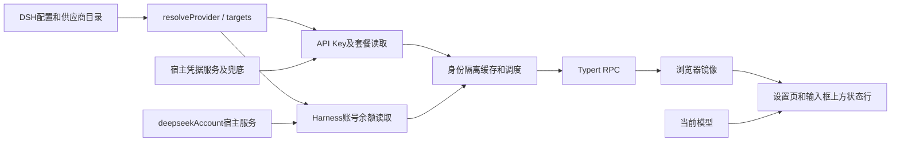

# 架构与验证

本文描述当前源码；历史测试数字和旧包校验值在 [归档](archive/validation-2026-10-10.md)，本次发布结果由实际Actions与分发字节确认。

## 数据流

浏览器不导入宿主Adapter，不接收密钥或登录grant。source目录、归一化快照与origin-only端点提示经RPC传输；设置页和状态行共享provider解析。

## 代码入口

| 位置 | 职责 |
|---|---|
| [src/index.ts](../src/index.ts) | 装配、读取当前宿主服务、选择账号/HTTP通道、监听turn/end及账号签出 |
| [shared/providers.ts](../src/shared/providers.ts)、[host/targets.ts](../src/host/targets.ts) | 模式/来源/覆盖解析，首个provider拥有source+mode目标 |
| [host/deepseek-account.ts](../src/host/deepseek-account.ts) | 当前登录身份摘要、宿主钱包读取、前后身份复核与安全错误 |
| [host/credentials.ts](../src/host/credentials.ts)、[provider-refs.ts](../src/host/provider-refs.ts)、[credential-fallback.ts](../src/host/credential-fallback.ts) | API Key候选、实时服务查找与直接回退 |
| [host/read.ts](../src/host/read.ts)、[sources](../src/host/sources/index.ts) | HTTP超时/镜像/错误分类，各来源request与parse |
| [host/refresh.ts](../src/host/refresh.ts) | 时钟、live策略、身份摘要、generation、去重、同身份旧值及stop |
| [host/service.ts](../src/host/service.ts)、[host/typert.ts](../src/host/typert.ts) | getState/describeCredentials与zod v4线上校验 |
| [host/settings.ts](../src/host/settings.ts)、[shared/config.ts](../src/shared/config.ts) | volatile Config、归一化与legacy迁移 |
| [client/index.tsx](../src/client/index.tsx)、[contribution.ts](../src/client/contribution.ts) | UI挂载、configForms、词典和RPC贡献 |
| [client/store.ts](../src/client/store.ts)、[settings-form.ts](../src/client/settings-form.ts) | 浏览器镜像/错误/在途、配置快照及写入 |
| [SettingsSection.tsx](../src/client/SettingsSection.tsx)、[StatusLine.tsx](../src/client/StatusLine.tsx) | provider设置与当前模型读数；账号模式显示登录提示 |
| [shared/display.ts](../src/shared/display.ts)、[client/status-text.ts](../src/client/status-text.ts) | 格式化、severity、状态文字和提示 |
| [tsdown.config.ts](../tsdown.config.ts)、[cordis.patch.yml](../cordis.patch.yml) | 三个预构建入口、客户端模块表、usage-state配置条目 |

## 关键边界

`UsageStateStore`在每次读取时重新解析目标和有效凭据。endpoint/pin/ref/preferredRefs构成目标签名，有效密钥或账号身份摘要进入私有缓存身份。配置代次变化拒绝旧结果；失败保留同身份成功读数。source+mode合并仍不是独立多账户注册。

账号路径先以 `getPlatformSession()` 获取Host内身份摘要，再调用 `getBalance(client)`，并复核身份。账号模式不执行API Key候选查找或Adapter的HTTP request；签出清缓存，Host任意错误先替换为安全文案。充值与赠送钱包由DeepSeek纯解析器处理。

普通 `getState(false)` 使用onlyIfMissing：初始化缺失/变化身份，其余返回镜像。宿主定时与回合刷新负责重新查询；force用于主动刷新。浏览器配置/凭据invalidate有独立generation，显式force遇普通在途RPC会排一次后续。

Host产物是ESM，client是模块加载器的单文件CJS工厂，Typert清单单独导出。三个bundle随源码入库，GitHub安装无需构建。平台共享依赖、codec工厂和服务绑定的要求见 [平台说明](platform-notes.md)。

## 验证能证明什么

| 层 | 入口 | 边界 |
|---|---|---|
| 数值和来源 | [sources测试](../tests/sources/deepseek.test.ts)、[providers测试](../tests/shared/providers.test.ts) | 单位、零/非法字段、模式解析；无真实厂商账户 |
| 宿主装配 | [entry测试](../tests/host/entry.test.ts)、[credential lookup](../tests/host/credential-lookup.test.ts) | 假服务下路由、凭据、签出/换号、晚响应及安全RPC |
| 调度/浏览器 | [refresh](../tests/host/refresh.test.ts)、[store](../tests/client/store.test.ts)、[render](../tests/client/render.test.ts)、[interactions](../tests/client/interactions.test.ts) | 时序、交互与SSR标记；非真实布局/凭据落盘 |
| 平台契约 | [host Typert](../tests/host/typert.test.ts)、[contribution](../tests/client/contribution.test.ts)、[bundle](../tests/build/bundle.test.ts) | 真实validator/registry校验源码与产物；非完整宿主安装 |
| 交付 | [artifacts](../scripts/verify-artifacts.mjs)、[package](../scripts/verify-package.mjs)、[runtime](../scripts/runtime-smoke.mjs) | HEAD一致性、实际tarball及独立预构建运行；账号服务使用fixture |

CI精确版本及job定义以 [工作流](../.github/workflows/ci.yml) 为准。0.4.7/0.4.8的历史浏览器安装证据在 [兼容性归档](archive/platform-compatibility-2026-10-17.md#dsh-021-compatibility)；0.4.9新增账号路径的真实账户/视觉待验项保留在 [Backlog](backlog.md)。
