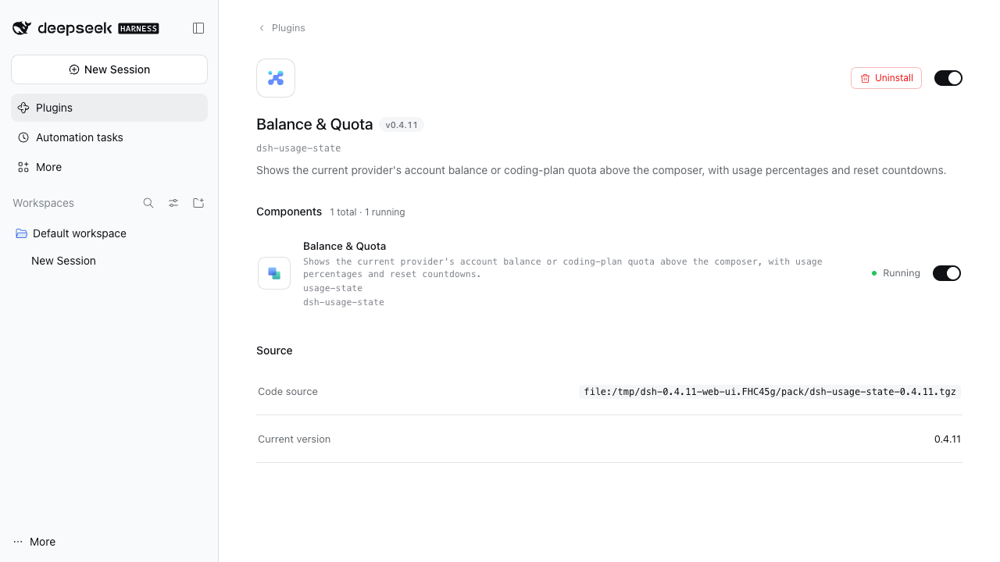
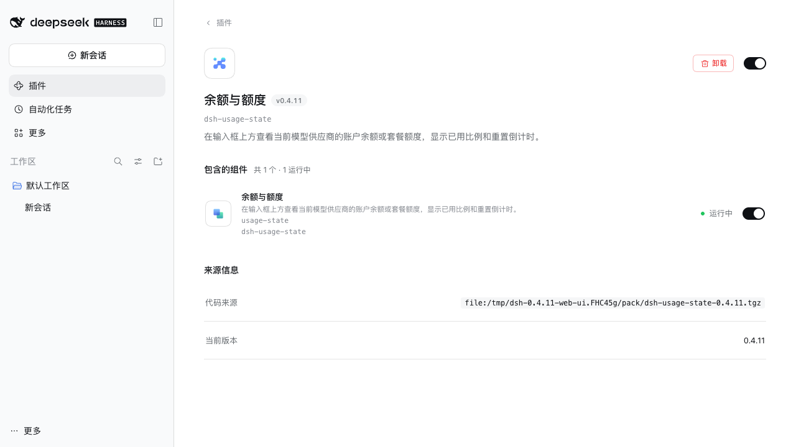

# 0.4.11 发布与验证

## 变更与审查

- 兼容性流程 [#14](https://github.com/takboo/dsh-usage-state/pull/14) 与 rc.5 候选 [#15](https://github.com/takboo/dsh-usage-state/pull/15) 已完成审查并按顺序合并。恢复签名与内容边界修复见 [审查记录](../reviews/compatibility-draft-prs-2026-10-30.md)。修复提交 `bfd5191d5ed0dd944e2dea5e3c2dfff6a11348d9` 的 [CI](https://github.com/takboo/dsh-usage-state/actions/runs/40995361815) 和合并后 `0b2738610e959c3fa6b3e4eb5a24cbcb357692e5` 的 [CI](https://github.com/takboo/dsh-usage-state/actions/runs/40995602600) 均通过。
- 新增官方 locale metadata 的中英文导出，插件页、组件和设置标题统一为“余额与额度 / Balance & Quota”；npm、包内英文说明保持一致。技术包名、设置/RPC 标识和支持范围不变。
- dshmarket 目录更新为 [上游 PR #10510](https://github.com/awesome-dsh-plugin/awesome-dsh-plugin/pull/10510)，只改现有条目的展示名与双语说明；当前上游 `readEntries` / `validateEntries` 校验通过。上游合并与目录重新构建另行决定线上可见时间。

## 候选验证

固定 Node24.21.0/npm11.19.1，类型检查、构建及385项测试通过。正式发布前还需提交全部 bundle 并完成 HEAD 一致性、真实打包、目标 main CI 和稳定 tag 发布验证。

隔离 rc.5 Web 检查以 npm 官方 tarball 安装，固定 integrity 为 `sha512-WkyJZv4zl9sCAxSzRctGm58m0rilGqwR6pniBiLOz5CPDfHfDuAUicg0AAazXI7oj/Cph6/cjNTncA/rpLTXpw==`。0.4.11 tarball 在全新 HOME/profile 中安装并激活，真实浏览器/Host RPC、模型切换、文件凭据优先级、状态行位置和 Hidden/API 往返通过。强制检查两种语言下的插件标题、描述和技术包名，没有使用显示文本桩件。

## 分发与边界

npm/GitHub 的正式包身份、同包 Node20 冒烟、provenance 与下载后的字节核对待正式发布后追加。上述宿主检查使用假凭据与 fixture 响应，真实 Desktop 账号钱包、厂商接口、凭据保存落盘和完整视觉验收保持在 [待办](../backlog.md)。
